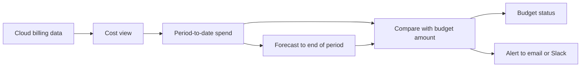
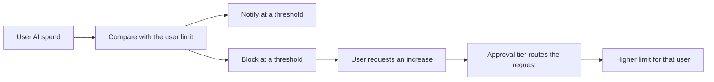

# Budgets

A budget is a spending limit for a period. Harness offers two kinds. A **resource budget** compares the cost in a cost view with an amount you set, then tells you when actual or forecasted spend crosses a threshold. A **user budget for AI spend** gives each person a limit on AI providers and can block that person when they reach it.

The two kinds answer different questions. A resource budget asks "Is this team, product, or environment on track for the month?" A user budget asks "How much can each developer spend on AI tools, and what happens when they need more?" Most organizations use both: resource budgets for planning and accountability, and user budgets for day-to-day control of AI spend.

---

## What you will learn from this topic

- **Budget types:** What a resource budget and a user budget each limit, and when to use each.
- **Periods and amounts:** How budget periods reset, and how growth rates and monthly breakdowns shape the amount.
- **Forecast:** How Harness estimates where spend will land at the end of the period.
- **Alerts and enforcement:** The difference between being told about spend and having spend stopped.
- **Data timing:** Why an alert can arrive after the spend that caused it.

---

## Choose a budget type

Start from the question you need answered.

| | Resource budget | User budget for AI spend |
| --- | --- | --- |
| Answers | Is this slice of cost on track for the period? | How much can each person spend on AI tools? |
| What it measures | Total cost in one cost view | Each covered user's AI spend |
| Who it applies to | The cost in the view, not a person | Users in Harness user groups, or users matched by one cost category and one bucket |
| What happens at the limit | Harness sends an alert | Harness can notify the user, block access, or both |
| Periods | Daily, weekly, monthly, quarterly, yearly | Weekly, monthly, quarterly |
| Who usually sets it up | FinOps, finance, or team leads | Platform or AI tooling administrators |

### Use cases

The following scenarios show which budget fits:

- **Monthly cloud cost for a business unit:** A FinOps lead creates a resource budget on the business unit's cost view, with alerts at 80% of actual spend and 100% of forecasted spend. The team lead hears about a likely overrun in the middle of the month, not on the invoice.
- **Annual plan tracked month by month:** A finance partner creates a yearly resource budget broken down by month, with a different amount for seasonal months. The history shows each month against its own target without editing the budget every month.
- **AI coding assistant rollout:** A platform administrator gives every engineer a monthly AI budget across all connected AI spend. Engineers get an email at 90% and lose access at 100%, and they can request a higher limit from their profile.
- **Power users:** A data science group needs more than the standard allowance. Rather than raise every limit, the administrator sets approval tiers so a team lead approves small increases and a manager approves larger ones.

---

## How a resource budget works

A resource budget watches one cost view. The cost view decides which cost counts: its rules, filters, cost categories, and cost preferences. The budget adds a period, an amount, and optional alerts.

Because the budget reads cost through the cost view:

- When the cost view uses amortized cost, the budget uses amortized cost.
- Discounts that the cost view includes are included in the budget.
- Shared cost buckets from cost categories count toward the budget.

You can create several budgets on the same cost view, for example a monthly budget for the team and a quarterly budget for its manager.


**A resource budget does not stop spend**

A resource budget reports and alerts. It does not change, stop, or scale down cloud resources. To act on spend automatically, pair the alert with your own process, or go to [How AutoStopping works](how-autostopping-works.md) to stop idle resources.


### Periods and amounts

The period sets the window that spend is measured over. Spend starts from zero at the beginning of each period. The amount is the limit for one period.

Three options shape the amount:

- **Growth rate:** Increase the amount by a percentage over later periods, for planned growth.
- **Monthly breakdown for a yearly budget:** Set a separate amount for each month instead of one annual figure.
- **Forecast override:** On a yearly budget with a monthly breakdown, replace the forecast for a month with your own value.

The period and start date are fixed once you create the budget. To track a different period, create a new budget.


**Budget amounts and currency**

When you change the currency preference for your account, existing budget amounts are not converted. Update each amount yourself. A cost view can span several cloud accounts, so Harness cannot convert the amount automatically.


### Status

Each resource budget shows a status of **Over**, **At risk**, or **OK**. The status compares current and forecasted spend with the amount, so you can spot a budget that is on track to overspend before it does.

---

## How a user budget works

A user budget gives each covered person the same limit for the period. The limit is per person, not shared. Ten people on a $100 monthly budget can each spend $100.

A user budget has four parts:

- **Scope:** Who the budget covers, by Harness user group or by one cost category and one bucket.
- **Applies to:** Which AI spend counts, from all connected AI spend to a single provider. The list shows the AI providers connected to your account. To set a different limit for each provider, create a separate budget for each provider.
- **Enforcement:** Thresholds that notify the user, block the user, or both.
- **Limit increase requests:** Optional approval tiers that decide who can approve how much.

Spend resets at the start of each period. Unused allowance does not carry forward.

### Notify and block

A threshold is a percentage of the user's limit. At each threshold you choose an action:

- **Notify** sends an email to the user, and to any other recipients you add.
- **Block** removes the user's access to the covered AI providers.

For example, notify at 90% and block at 100%. The user gets a warning while they can still change course, then a hard stop at the limit.

Harness also emails the user when they are blocked, when they submit a request, and when they are unblocked. These emails are sent whatever thresholds you configure.


**Blocking needs enforcement on the connector**

Block only works for providers whose connector has enforcement enabled, and only for providers that support it. Go to [What's supported](../get-started/whats-supported.md) to check which providers support user budget enforcement.


### Limit increase requests and approval tiers

When requests are allowed, a user can ask for a higher limit from **Profile** > **AI Budgets**. Each approval tier sets a ceiling and an approver. Harness sends the request to the tier whose ceiling covers the amount asked for. The highest ceiling is the most anyone can request.

Consider a $125 monthly budget with three tiers:

| Tier | Requests up to | Approved by |
| --- | --- | --- |
| 1 | $250 | Team lead |
| 2 | $500 | Engineering manager |
| 3 | $750 | VP of Engineering |

A request for $200 goes to the team lead. A request for $400 goes to the engineering manager. Nobody can request more than $750. A tier can also auto-approve, which suits small, low-risk increases.

An approved increase raises the limit for that user only. Everyone else in the budget keeps the default.

---

## Forecast

The forecast estimates where spend will land at the end of the current period if the current pace continues. It appears on resource budgets, and forecasted-spend alerts use it.

The forecast uses an average daily spend across all the history the budget has:

- **Average daily spend** is `(H + C) / Dh`.
- For a **daily** budget, the forecast is the average daily spend.
- For **weekly, monthly, quarterly, and yearly** budgets, the forecast is `C + (average daily spend × R)`.

The terms in the formula are:

- **H:** Actual cost across all completed periods.
- **C:** Actual spend in the current period so far, from the start of the period through yesterday.
- **Dh:** Days of history, from the first day through yesterday, inclusive.
- **R:** Calendar days remaining, from today through the last day of the period.

**Example.** A monthly budget runs from 1 January to 31 January. Today is 10 January.

- Spend in completed periods (H) is $48,000 over 101 days of history (Dh).
- Spend so far this month (C) is $8,600, and 21 days remain (R).
- Average daily spend is ($48,000 + $8,600) / 101, which is about $560.
- The forecast is $8,600 + ($560 × 21), which is $20,360.

The forecast uses the long-run average, not only the current month. A sudden spike in the current period moves the forecast less than it moves spend.

---

## Alert thresholds

A resource budget alert fires when spend exceeds a percentage of the amount. Each alert watches one of two measures:

- **Actual spend:** What has been spent so far in the period.
- **Forecasted spend:** Where spend is expected to land at the end of the period.

Take a $10,000 monthly budget:

- An alert at **80% of actual spend** fires once you have spent $8,000.
- An alert at **100% of forecasted spend** fires as soon as the forecast passes $10,000, even if you have spent only $4,000 so far.

Use actual-spend alerts to confirm that a limit has been reached. Use forecasted-spend alerts to get warning while there is still time to act. Alerts go to email or Slack. A budget does not need alerts; you can create one only to track status.

Go to [Create a resource budget](../cost-governance/budgets/create-a-resource-budget.md#setup-alerts) to add an alert. Go to [Manage resource budgets](../cost-governance/budgets/manage-resource-budgets.md#change-alerts) to change alerts on a budget that already exists.

---

## Data timing

Budgets evaluate cost after Harness ingests it, not at the moment of use. An alert can therefore arrive after the spend that triggered it.

- **AI provider spend** can take 6 to 12 hours to appear from a provider connector.
- **Cloud billing data** can arrive later still. Billing-accurate cost from some sources lands two to three days after the usage day.
- **Daily budgets** are checked every hour. Daily alert emails show the date the cost was incurred, not the date the alert was sent.

Set thresholds with this delay in mind. If an overrun matters, alert at a lower percentage, or use a forecasted-spend alert, so you have room to act before the period ends.

---

## Access and auditing

Budgets use Harness role-based access control:

- **Budgets: View** opens the Budgets page.
- **Budgets: Edit** creates and changes resource budgets.
- **Budgets: Delete** removes a budget.

A resource budget lives in a folder. You need access to that folder to view the budget and its cost view. Harness records budget create, update, and delete events in the audit trail.

Go to [Permissions and RBAC](permissions-and-rbac.md) to assign roles.

---

## Common misconceptions

**"A resource budget will stop my cloud spend at the limit."**
It will not. A resource budget reports and alerts. Only a user budget for AI spend can block access, and only on providers with enforcement enabled.

**"A user budget is a shared pool for the group."**
It is not. The amount applies to each person. A group of 20 on a $50 budget can spend up to $1,000 in total.

**"An alert fires the moment spend crosses the threshold."**
Alerts run on ingested data, which lags usage by hours, and sometimes days for cloud billing. Leave headroom in your thresholds.

**"Deleting a user budget leaves blocks in place."**
Deleting a user budget removes its enforcement rules immediately. Users it blocked regain access.

---

## Related concepts

- Go to [Budgets](../cost-governance/budgets/README.md) to create and manage resource budgets and user budgets.
- Go to [Cost views](cost-views.md) to understand what a resource budget measures.
- Go to [Cost categories and shared costs](cost-categories-and-shared-costs.md) to understand buckets used in budget scope and shared cost.
- Go to [Manage your AI budget](../cost-governance/user-budgets/manage-your-ai-budget.md) to view your own AI limit and request an increase.


