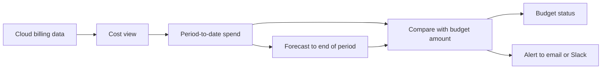
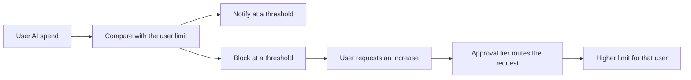

# Budgets

A budget is a spending limit for a period. Harness has two types:

- **Resource budget:** Compares the cost in a cost view with an amount you set, and informs you when actual or forecasted spend crosses a threshold. Use it to check whether a team, product, or environment is on track for the period.
- **User budget for AI spend:** Sets a limit for each user on AI providers. Harness can notify that user, block access, or both when spend reaches the limit. Use it to control AI spend per user, including requests for a higher limit.

Most accounts use both. Resource budgets support planning. User budgets control day-to-day AI spend.

---

## What you will learn from this topic

- What a resource budget and a user budget limit, and when to use each
- How a period resets, and how a growth rate or a monthly breakdown sets the amount
- How Harness estimates spend at the end of the period
- How an alert reports spend, and how a user budget can block access
- Why an alert can arrive hours after the spend that triggered it

---

## Before you begin

- A resource budget measures the cost in one cost view. The cost view selects which cost counts. Navigate to [Cost views](cost-views.md) to review what a cost view includes.
- A user budget sets the same limit for each user in a Harness user group. Navigate to [Manage user groups](https://app.gitbook.com/s/iHCl4N3pQkjhOYjQoOs7/harness-platform-resources/platform-access-control/add-user-groups) to create a user group.

---

## Budget types

Compare the two types before you create a budget.

| | Resource budget | User budget for AI spend |
| --- | --- | --- |
| Purpose | Whether a cost view is on track for the period | How much each user can spend on AI tools |
| Cost tracked | Total cost in one cost view | Each user's AI spend |
| Scope | The cost in the view | Users in a Harness user group, or users in one cost category and one bucket |
| When the limit is reached | Harness sends an alert | Harness can notify the user, block access, or both |
| Period | Daily, weekly, monthly, quarterly, yearly | Weekly, monthly, quarterly |
| Best suited for | FinOps or a team lead | A platform or AI tooling administrator |

### Use cases

A resource budget covers the cloud cost cases. A user budget covers the AI spend cases.

- **Track a team for the month:** Set a monthly resource budget on the team's cost view. Add an alert at 80% of actual spend and an alert at 100% of forecasted spend. Harness sends both alerts to the team lead during the month, before the invoice arrives.
- **Track a yearly plan month by month:** Set a yearly resource budget with a separate amount for each month, instead of one amount for the year. For example, enter $8,000 for January and $15,000 for December. Budget history shows each month's spend next to that month's amount. You enter the 12 amounts once.
- **Limit AI spend for each user:** Set a monthly user budget for all connected AI spend, with the same limit for each user. Harness emails the user at 90% of the limit and blocks access at 100%.
- **Approve a higher limit for one user:** Set approval tiers for limit increase requests. Harness sends a request within the lower ceiling to a team lead, and a request within the higher ceiling to a manager. An approved increase applies to that user only. Every other user keeps the default amount.

---

## How a resource budget works

A resource budget measures one cost view. The cost view selects the cost: its rules, filters, cost categories, and cost preferences. The budget adds a period, an amount, and optional alerts.

The budget uses the same cost as the cost view:

- When the cost view uses amortized cost, the budget uses amortized cost.
- When the cost view includes discounts, the budget includes those discounts.
- Shared cost buckets from cost categories count toward the budget.

You can create several budgets on the same cost view, for example a monthly budget for the team and a quarterly budget for its manager.


**A resource budget does not stop spend**

A resource budget reports and alerts. It does not change, stop, or scale down cloud resources. To act on spend automatically, pair the alert with your own process, or navigate to [How AutoStopping works](how-autostopping-works.md) to stop idle resources.


### Periods and amounts

The period sets the window that spend is measured over. Spend starts from zero at the beginning of each period. The amount is the limit for one period.

Three options set the amount:

- **Growth rate:** Increase the amount by a percentage over later periods, for planned growth.
- **Monthly breakdown for a yearly budget:** Set a separate amount for each month instead of one annual figure.
- **Forecast override:** On a yearly budget with a monthly breakdown, replace the forecast for a month with your own value.

The period and start date are fixed once you create the budget. To track a different period, create a new budget.


**Budget amounts and currency**

When you change the currency preference for your account, Harness does not convert existing budget amounts. Update each amount yourself. A cost view can span several cloud accounts, so Harness cannot convert the amount automatically.


### Status

Each resource budget shows a status of **Over**, **At risk**, or **OK**. The status compares current spend and forecasted spend with the amount. **At risk** means the forecast exceeds the amount before the period ends.

---

## How a user budget works

A user budget sets the same limit for each user in the period. The limit is per user, not shared. With 10 users on a $100 monthly budget, each user can spend $100.

A user budget has four parts:

- **Scope:** Who the budget covers, by Harness user group or by one cost category and one bucket.
- **Applies to:** Which AI spend counts, from all connected AI spend to a single provider. The list shows the AI providers connected to your account. To set a different limit for each provider, create a separate budget for each provider.
- **Enforcement:** Thresholds that notify the user, block the user, or both.
- **Limit increase requests:** Optional approval tiers that decide who can approve how much.

Spend resets at the start of each period. Unused allowance does not carry forward.

### Notification and blocking

A threshold is a percentage of the user limit. At each threshold, select an action:

- **Notify** sends an email to the user, and to any other recipients you add.
- **Block** removes the user's access to the covered AI providers.

For example, notify at 90% and block at 100%. The user receives a warning at 90% and loses access at 100%.

Harness also emails the user when they are blocked, when they submit a request, and when they are unblocked. Harness sends these emails regardless of the thresholds you configure.


**Blocking needs enforcement on the connector**

Block only works for providers whose connector has enforcement enabled, and only for providers that support it. Navigate to [What's supported](../get-started/whats-supported.md) to check which providers support user budget enforcement.


### Limit increase requests and approval tiers

When you allow requests, a user requests a higher limit from **Profile** > **AI Budgets**. Each approval tier sets a ceiling and an approver. Harness sends the request to the tier whose ceiling covers the requested amount. The highest ceiling is the maximum any user can request.

Consider a $125 monthly budget with three tiers:

| Tier | Requests up to | Approved by |
| --- | --- | --- |
| 1 | $250 | Team lead |
| 2 | $500 | Engineering manager |
| 3 | $750 | VP of Engineering |

A request for $200 goes to the team lead. A request for $400 goes to the engineering manager. No user can request more than $750. A tier can use **Auto-approve** for small increases that do not need a reviewer.

An approved increase raises the limit for that user only. Everyone else in the budget keeps the default.

---

## Forecast

The forecast estimates spend at the end of the current period if the current pace continues. Resource budgets show the forecast, and forecasted-spend alerts use it.

The forecast uses an average daily spend across all the history the budget has:

- **Average daily spend** is `(H + C) / Dh`.
- For a **daily** budget, the forecast is the average daily spend.
- For **weekly, monthly, quarterly, and yearly** budgets, the forecast is `C + (average daily spend × R)`.

The terms in the formula are:

- **H:** Actual cost across all completed periods.
- **C:** Actual spend in the current period so far, from the start of the period through yesterday.
- **Dh:** Days of history, from the first day through yesterday, inclusive.
- **R:** Calendar days remaining, from today through the last day of the period.

**Example.** A monthly budget runs from 1 January to 31 January. Today is 10 January.

- Spend in completed periods (H) is $48,000 over 101 days of history (Dh).
- Spend so far this month (C) is $8,600, and 22 days remain (R).
- Average daily spend is ($48,000 + $8,600) / 101, which is about $560.
- The forecast is $8,600 + ($560 × 22), which is $20,920.

The forecast uses the long-run average across all past periods. A sudden spike in the current period moves the forecast less than it moves spend.

---

## Alert thresholds

Harness sends a resource budget alert when spend exceeds a percentage of the amount. Each alert uses one of two measures:

- **Actual spend:** Spend so far in the period.
- **Forecasted spend:** The estimate of spend at the end of the period.

On a $10,000 monthly budget:

- Harness sends an alert at **80% of actual spend** when spend reaches $8,000.
- Harness sends an alert at **100% of forecasted spend** when the forecast passes $10,000, even if spend so far is $4,000.

Use an actual-spend alert to confirm that a limit is reached. Use a forecasted-spend alert to get a warning while time remains in the period. Harness sends alerts by email or Slack. Alerts are optional. You can create a budget only to track status.

Navigate to [Create a resource budget](../cost-governance/budgets/create-a-resource-budget.md#setup-alerts) to add an alert. Navigate to [Manage resource budgets](../cost-governance/budgets/manage-resource-budgets.md#change-alerts) to change alerts on a budget that already exists.

---

## Data timing

Harness checks a budget against cost after it ingests the cost data, not at the moment of use. An alert can arrive after the spend that caused it.

- **AI provider spend** can take six to 12 hours to appear from a provider connector.
- **Cloud billing data** can take longer. Billing-accurate cost from some sources arrives two to three days after the usage day.
- **Daily budgets:** Harness checks a daily budget every hour. The alert email shows the date the cost was incurred, not the date Harness sent the alert.

Set thresholds with this delay in mind. If an overrun matters, alert at a lower percentage, or use a forecasted-spend alert, so you have room to act before the period ends.

---

## Access and auditing

Budgets use Harness role-based access control:

- **Budgets: View** opens the Budgets page.
- **Budgets: Edit** creates and changes resource budgets.
- **Budgets: Delete** removes a budget.

Harness stores each resource budget in a folder. You need access to that folder to view the budget and its cost view. Harness records budget create, update, and delete events in the audit trail.

Navigate to [Permissions and RBAC](permissions-and-rbac.md) to assign roles.

---

## Common misconceptions

**"A resource budget stops cloud spend at the limit."**
A resource budget does not stop spend. It reports and alerts. Only a user budget for AI spend can block access, and only on providers with enforcement enabled.

**"A user budget is a shared pool for the group."**
A user budget is not a shared pool. The amount applies to each user. A group of 20 users on a $50 budget can spend up to $1,000 in total.

**"Harness sends an alert the moment spend crosses the threshold."**
Alerts run on ingested data. The data can lag usage by hours, and by days for cloud billing. Set the threshold low enough that you can act before the period ends.

**"Deleting a user budget leaves blocks in place."**
Deleting a user budget removes its enforcement rules immediately. Users who were blocked regain access.

---

## Related concepts

- Navigate to [Budgets](../cost-governance/budgets/README.md) to create and manage resource budgets and user budgets.
- Navigate to [Cost views](cost-views.md) to understand what a resource budget measures.
- Navigate to [Cost categories and shared costs](cost-categories-and-shared-costs.md) to understand buckets used in budget scope and shared cost.
- Navigate to [Manage your AI budget](../cost-governance/user-budgets/manage-your-ai-budget.md) to view your own AI limit and request an increase.


