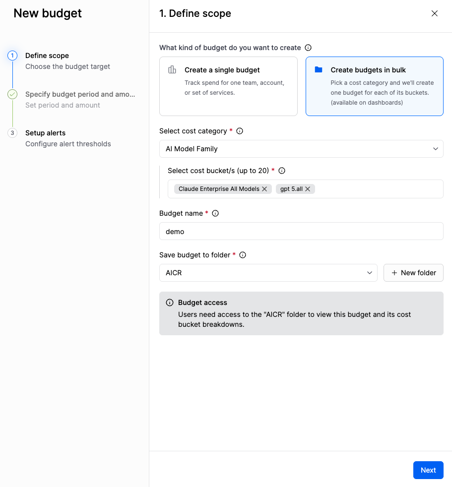

# Create a resource budget

Create a resource budget for one cost view, or create budgets in bulk for the buckets in a cost category. Set the scope, the budget period and amount, and the alert thresholds. To compare a resource budget with a user budget for AI spend, navigate to [Budgets](../../concepts/budgets.md).

---

## What you will learn from this topic

- **Scope:** How to associate a single budget with a cost view, or bulk budgets with a cost category, and save them to a folder.
- **Period and amount:** How to set the budget period, start date, amount, and an optional growth rate.
- **Alerts:** How to set alert thresholds before you save the budget.

---

## Before you begin

- **A cost view or a cost category:** A single budget tracks one cost view. Bulk budgets track up to 20 buckets in one cost category. Navigate to [Create a cost view](../../cost-visibility/cost-views/create-a-cost-view.md) to create a cost view.
- **Budgets: Edit:** You need this permission to create a budget. An administrator grants it through a role. Navigate to [Budgets](../../concepts/budgets.md#access-and-auditing) to review budget permissions.
- **Folder access:** You need access to the destination folder. Without it, you cannot view the budget. Navigate to [Organize budgets in folders](manage-resource-budgets.md#organize-budgets-in-folders) to manage folders.

---

## Create the budget

### Define scope

1. Navigate to **Cloud & AI Costs**, and then select **Budgets**.
2. On the **Resource budgets** tab, click **New budget**, and then select **Resource budget**.




1. Select **Create a single budget**.
2. In **Select a cost view**, select the cost view to track.
3. In **Budget name**, enter a name.
4. In **Save budget to folder**, select a folder, or click **New folder**.
5. Click **Next**.





1. Select **Create budgets in bulk**.
2. In **Select cost category**, select the cost category.
3. In **Select cost bucket/s**, select up to 20 buckets. Harness creates one budget for each bucket.
4. In **Budget name**, enter a name.
5. In **Save budget to folder**, select a folder, or click **New folder**.
6. Click **Next**.




### Specify budget period and amount

1. In **Budget period**, select **Daily**, **Weekly**, **Monthly**, **Quarterly**, or **Yearly**.
2. For **Yearly**, select **Break the budget down by month**, and then enter an amount for each month.
   - Click **Copy to all** to apply one month's amount to the remaining months.
   - (Optional) Under **Advanced configuration**, enter a forecast for a month in **Override forecasted spend for each month**.
3. In **Start date**, select the first day of the budget period.
4. In the amount field, enter an amount greater than 0.
5. (Optional) Select **Add growth rate to budget amount**, and then enter a percentage in **Growth rate (%)**.
6. Click **Next**.


**The period and start date stay fixed**

Harness keeps the period and start date after you save. To use a different period, create a new budget.


### Set up alerts

1. Click **Add alert**.
2. In **When**, select **Actual spend** or **Forecasted spend**.
   - **Actual spend:** Harness sends the alert when spend in the current period reaches the percentage.
   - **Forecasted spend:** Harness sends the alert when the forecast for the end of the period reaches the percentage.
3. In **Enter %**, enter the percentage of the budget amount.
4. Under **Send alerts to**, in **Channel**, select **Email** or **Slack**.
5. In **Recipients**, enter who receives the alert. For **Email**, the field shows **Enter e-mail IDs**.
6. Click **Add alert** to add another alert.
7. To delete an alert, click the delete icon on its row.
8. Click **Add a custom message to the alert (optional)** to add text to the notification.
9. Click **Save**.

---

## Next steps

- Navigate to [Manage resource budgets](manage-resource-budgets.md) to find the budget, move it to a folder, update its alerts, and review budget history.


