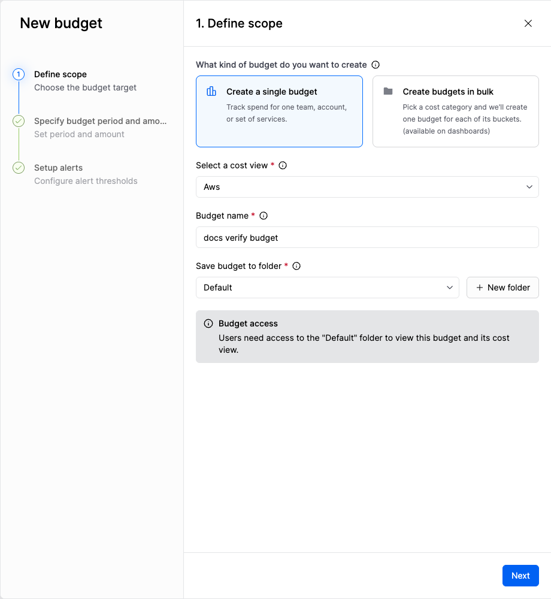
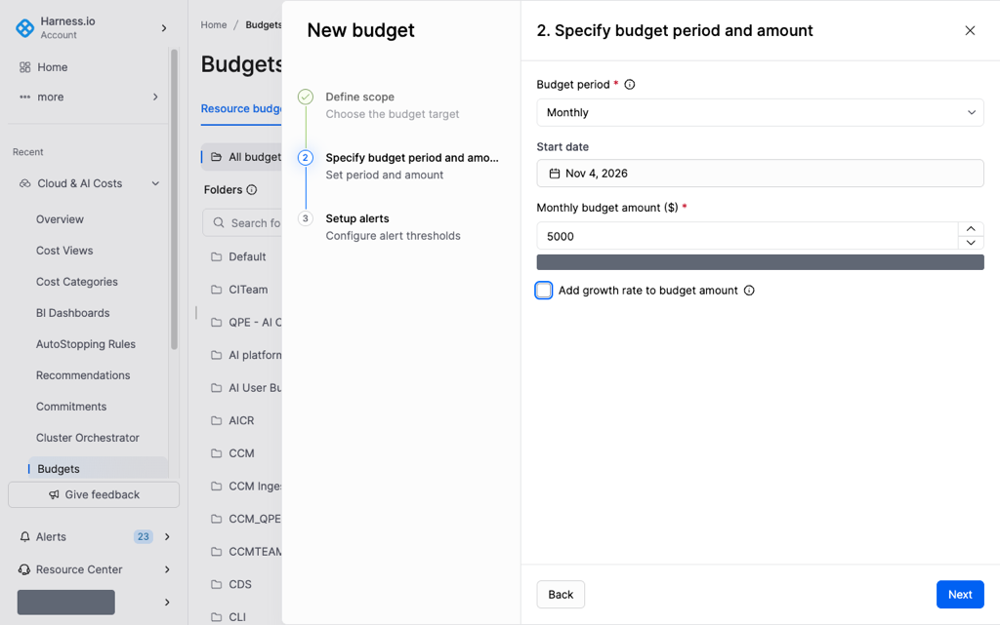
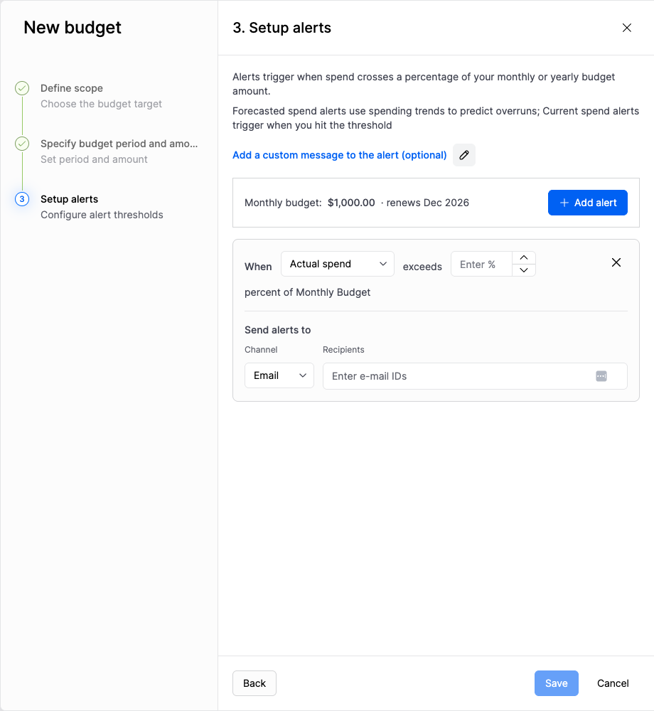

# Create a resource budget

Create a resource budget to track spend for one cost view. Set the scope, the budget period and amount, and the alert thresholds.

Go to [Budgets](../../concepts/budgets.md) to compare a resource budget with a user budget for AI spend.

---

## What you will learn from this topic

- **Scope:** How to associate a budget with a cost view and a folder.
- **Period and amount:** How to set the budget period, start date, amount, and an optional growth rate.
- **Alerts:** How to configure alert thresholds before you save the budget. Go to [Manage resource budgets](manage-resource-budgets.md#change-alerts) to update alerts after the budget is created.

---

## Before you begin

- **A cost view:** The budget tracks cost for one cost view. Go to [Create a cost view](../../cost-visibility/cost-views/create-a-cost-view.md) to create a cost view.
- **Budgets: Edit:** This permission is required to create a budget. An administrator grants the permission through a role. Go to [Budgets](../../concepts/budgets.md#access-and-auditing) to review budget permissions.
- **Folder access:** Access to the destination folder is required. Without that access, you cannot view the budget or its cost view. Go to [Organize budgets in folders](manage-resource-budgets.md#organize-budgets-in-folders) to manage folders.

---

## Create the budget

### Define scope

1. Go to **Cloud & AI Costs**, and then select **Budgets**.
2. On the **Resource budgets** tab, click **New budget**, and then select **Resource budget**.
3. Select **Create a single budget**.
4. In **Select a cost view**, select the cost view to track.
5. In **Budget name**, enter a name.
6. In **Save budget to folder**, select a folder, or click **New folder**.
7. Click **Next**.

**Budget access** states that access to the selected folder is required to view the budget and its cost view. You can create more than one budget for the same cost view.

### Specify budget period and amount

1. In **Budget period**, select **Daily**, **Weekly**, **Monthly**, **Quarterly**, or **Yearly**.
2. If you select **Yearly**, set an amount for each month.
   - Select **Break the budget down by month**, and then enter an amount for each month.
   - Click **Copy to all** to apply one month's amount to the remaining months.
   - Under **Advanced configuration**, enter a forecast for a month in **Override forecasted spend for each month**.
3. In **Start date**, select the first day of the budget period.
4. In **Monthly budget amount ($)**, enter an amount greater than 0. The label changes to match **Budget period**.
   - When the amount is not greater than 0, Harness displays **Budget amount must be greater than 0**.
   - Below the field, Harness displays the spend for the last period under **Last period's spend for this cost view**.
5. Select **Add growth rate to budget amount**, and then enter a percentage in **Growth rate (%)**.
   - When **Growth rate (%)** is empty, Harness displays **Enter a growth rate**.
6. Click **Next**.

### Setup alerts

1. Click **Add alert**.
2. Configure the alert row.
   - In **When**, select **Actual spend** or **Forecasted spend**.
     - **Actual spend** triggers when spend in the current period reaches the percentage.
     - **Forecasted spend** triggers when the forecast for the end of the period reaches the percentage.
   - In **Enter %**, enter the percentage of the budget amount. The row ends with **percent of Monthly Budget**, and that wording changes with **Budget period**.
   - Under **Send alerts to**, in **Channel**, select **Email** or **Slack**.
   - In **Recipients**, enter who receives the alert. For **Email**, the field displays **Enter e-mail IDs**.
3. Click **Add alert** to add another alert.
4. Click the remove icon on a row to delete that alert.
5. Click **Add a custom message to the alert (optional)** to add text to the notification.
6. Click **Save**.

The summary above the alerts shows the budget amount and the renewal period. The budget is listed on the **Resource budgets** tab.

---

## Next steps

- Go to [Manage resource budgets](manage-resource-budgets.md) to find the budget, move it to a folder, update its alerts, and review budget history.


