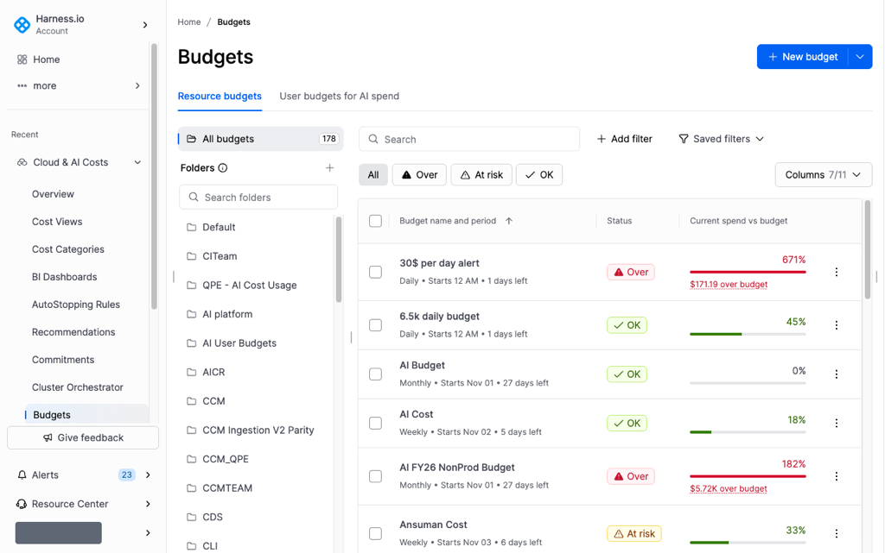

# Manage resource budgets

Use the **Resource budgets** tab to find a budget, organize it in a folder, change its alerts, and track spend against the limit.

---

## What you will learn from this topic

* How to search, filter, and choose columns on the resource budget list
* How to create a folder and move a budget into it
* How to change alerts for one budget or for several budgets
* How to read the budget detail page and budget history

---

## Before you begin

* At least one resource budget. Go to [Create a resource budget](create-a-resource-budget.md) to create one.
* Access to the folder that contains the budget. People who can open that folder can view the budget and its cost view.

---

## Open the Resource budgets tab

In the left navigation, select **Cloud & AI Costs**, then select **Budgets**.

Select the **Resource budgets** tab.

---

## Find a budget

Use the **Search** field to find a budget by name.

### Filter the list

Click **All**, **Over**, **At risk**, or **OK** to filter by status.

Click **Add filter**, then select a filter:

* **Created by:** Filter by the budget creator.
* **Last modified:** Select **Last 7 Days**, **Last 30 Days**, **Last 90 Days**, or **Select custom range**.
* **Min budget amount ($)** and **Max budget amount ($):** Set the lowest and highest budget amounts to include.
* **Period:** Select **Daily**, **Weekly**, **Monthly**, **Quarterly**, or **Yearly**.
* **Cost view:** Show budgets for one cost view.
* **Scope type:** Select **Perspective** or **Cost bucket**.
* **Cost category:** Show budgets for a cost category.

The filter appears as a chip. Click **Reset** to clear the filters. Click **Save** to save the current filters. Select **Saved filters** to apply a saved set.

### Choose columns

Click **Columns**. The control shows **7/11** when seven of the eleven columns are visible.

These columns are visible by default:

* **Budget name and period**
* **Status**
* **Current spend vs budget**
* **Pace**
* **Budget**
* **Current spend (MTD)**
* **Actions**

Select any of these to add them:

* **End of month forecast**
* **Alert thresholds**
* **Created by**
* **Last modified**

The **Budget** column shows the budget amount. **Pace** shows the pace for the period, including when spend is over the budget.

---

## Organize budgets in folders

The **Folders** panel lists **All budgets** and your folders. Select a folder to show the budgets in it. Select **All budgets** to return to the full list.

Use **Search folders** to find a folder by name.


**Folder access**

To view a resource budget and its cost view, you need access to the folder that contains the budget. When you save a budget to the **Default** folder, users need access to that folder to view the budget and its cost view.


Click **New folder**, enter a folder name, then save the folder.

To move a budget, click **Show more actions** on the budget row, then select **Move to folder**. Select the destination folder.

You can also choose the folder in **Save budget to folder** when you create the budget. Go to [Create a resource budget](create-a-resource-budget.md#define-scope) for that step.

---

## Work with one budget

Click **Show more actions** on the budget row, then select one of the following:

* **Edit:** Open the budget and change its settings, including its alerts.
* **Subscribe to alerts:** Receive this budget's alerts.
* **Move to folder:** Change the folder. Go to [Organize budgets in folders](#organize-budgets-in-folders) for the folder panel.
* **Delete:** Remove the budget.


**Delete is permanent**

Once a budget is deleted, it cannot be restored.


---

## Change alerts

A resource budget alert fires when actual spend or forecasted spend exceeds a percentage of the budget. The notification goes to email or to Slack.

### Change alerts on one budget

Click **Show more actions** on the budget row, then select **Edit**. On the detail page, click **Edit budget**.

Update the alert rows, then save. Each row sets **Actual spend** or **Forecasted spend**, a percentage, a **Channel** of **Email** or **Slack**, and **Recipients**. Go to [Create a resource budget](create-a-resource-budget.md#setup-alerts) for the fields on an alert row.

Select **Subscribe to alerts** on the row to receive the alerts configured for that budget.

### Change alerts on several budgets

Select one or more budgets, then click **Bulk actions**, then select **Manage alerts**.

Select one of the following:

* **Delete all alerts**
* **Add recipients to existing alerts**
* **Remove recipients from existing alerts**
* **Add new alerts**

For a new alert, the dialog says "Thresholds apply as a % of each budget's own amount."

---

## Work with several budgets

Select one or more budgets, then click **Bulk actions**.

* **Adjust budget amount:** Select **Increase by**, **Decrease by**, or **Set to**. Select **$** or **%**. The dialog says "Budget amounts will be updated. This can't be undone." Click **Update budgets** to apply the change, or click **Cancel** to leave the amounts unchanged.
* **Manage alerts:** Change thresholds or recipients for the selected budgets. Go to [Change alerts on several budgets](#change-alerts-on-several-budgets) for the options.
* **Clone:** Duplicate the selected budgets.
* **Delete:** Remove the selected budgets.

---

## Open a budget detail page

Click a budget name to open its detail page.

The detail page shows:

* **Status**
* **Period**
* **View on**
* **Budget**
* **Current spend** for the period to date, with the percentage of the budget used and the days left in the period
* **Forecast** for the end of the period
* **Alerts configured**

Click **Edit budget** to change the budget, including its alerts. Click **More**, then select **Delete** to remove it.

### Budget history

The **Budget history** chart shows past spend, period-to-date spend, spend over budget, forecast, and the period budget. Use the legend toggles to show or hide a series.

The history table lists each period with these columns:

| Column | Description |
| --- | --- |
| Actual cost | Spend incurred in the period |
| Budgeted cost | Budget amount for the period |
| Budget variance ($) | Dollar difference between actual and budgeted cost |
| Budget variance (%) | Percentage difference between actual and budgeted cost |

---

## Next steps

* Go to [Create a resource budget](create-a-resource-budget.md) to add another budget.
* Go to [User budgets](../user-budgets/README.md) to set a per-user limit on AI spend.


