# Create and manage user budgets

Create a user budget to set the same AI spending limit for each user in a Harness user group. Set up the connector, complete the budget wizard, and review limit increase requests.

---

## What you will learn from this topic

- **Create a budget:** How to set the scope, period, and spending limit.
- **Approval tiers:** How users request a higher limit, and who approves each amount.
- **Enforcement:** How to notify a user or block access at a spend threshold.
- **Monitor:** How to read spend and user health on the budget detail page.
- **Review requests:** How to approve or reject a limit increase.

---

## Before you begin

- **Cloud & AI Cost Management:** The module is enabled on your account.
- **Budget permissions:** Navigate to [Access and auditing](../../concepts/budgets.md#access-and-auditing) to review **Budgets: View**, **Budgets: Edit**, and **Budgets: Delete**.
- **User group:** The users in the budget belong to a Harness user group. Navigate to [Create a user group](#create-a-user-group) to create one from the budget wizard.
- **Budget enforcement:** Select **AI Governance** on the AWS connector for Amazon Bedrock, or turn on **Enable budget enforcement** on the provider connector for Cursor, GitHub Copilot, and Claude. Navigate to [Enable AI Governance on your connector](#enable-ai-governance-on-your-connector) to turn it on.

---

## Prepare the connector and the user group

### Enable AI Governance on your connector

Harness enforces a user budget only on a connector that has AI Governance turned on. Turn it on when you set up the connector. The steps depend on the connector type.



Use the following steps for Cursor, GitHub Copilot, and Anthropic Enterprise. The Cursor connector is shown below.


**Anthropic (Platform) is not supported**

Enforcement is available for Anthropic Enterprise only.


1. In the left navigation, select **Cloud & AI Integrations**.
2. Select the **AI providers** tab, then click **Add an AI provider**.
3. Select the provider. The panel title includes the provider name, for example **Create Cursor - Cloud cost connector**. For Anthropic, select **Anthropic Enterprise** under **Anthropic product type**.
4. Enter a **Name**.
5. Turn on **Enable budget enforcement**. When a user exceeds the budget, Harness can restrict or block that user's AI access. Enforcement requires a key with write access.

   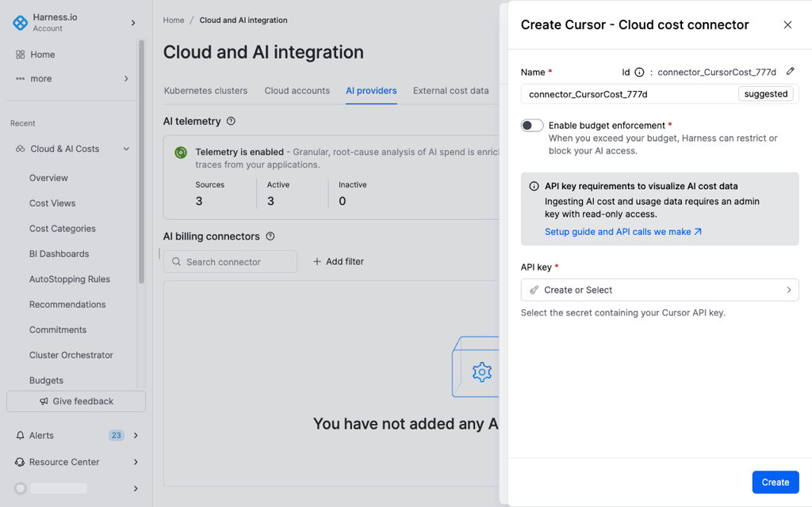

6. In **API key**, select or create the secret that holds the provider API key. Ingesting cost and usage data requires an admin key with read-only access.
7. Click **Create**.



Amazon Bedrock is enabled on the AWS cloud connector. The wizard has five steps: **Overview**, **Cost and usage report**, **Choose requirements**, **Authentication**, and **Create cross account role**.

1. In the left navigation, select **Cloud & AI Integrations**.
2. Select the **Cloud accounts** tab and open the AWS connector.
3. Enter the connector details in **Overview**, then complete **Cost and usage report**.
4. In **Choose requirements**, select **AI Governance**. Harness can then block a user's Amazon Bedrock access when the user exceeds the budget.

   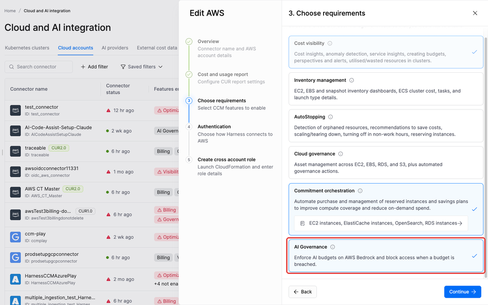

5. Complete **Authentication**.
6. In **Create cross account role**, do the following:
   1. Click **Launch CloudFormation stack** and create the stack in AWS. To deploy it yourself, download the CloudFormation template instead.
   2. Leave the **External ID** as shown. Harness enters the value.
   3. Enter the **Cross account role ARN** from the stack.
   4. Enter the **AI governance role name**. This is the IAM role your Bedrock users assume. For a role that AWS IAM Identity Center manages, include the `AWSReservedSSO_` prefix and the suffix, for example `AWSReservedSSO_<permission-set-name>_<suffix>`.
   5. Enter the **IAM policy name**. Harness includes this name in the CloudFormation template and uses the policy to block access.

   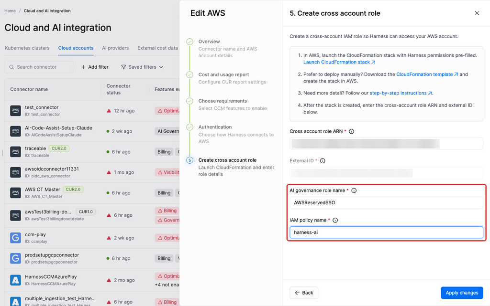

7. Click **Apply changes**.


**Attach the policy for IAM Identity Center roles**

Harness cannot automatically attach the governance policy to a Bedrock target role that AWS IAM Identity Center manages. The CloudFormation stack still creates the policy, but you must attach it yourself:

1. In IAM Identity Center, open the permission set for the role.
2. Add the **IAM policy name** you entered as a customer managed policy.
3. Re-provision the permission set to your AWS accounts.

Until you attach the policy, Harness cannot block users on Bedrock.




### Create a user group

You can create a user group from the **Select user groups** field in the budget wizard.

1. Click **+ Create new**. The **Add User Group** panel opens.
2. Complete the fields described in the following table.
3. Click **Add** to create the group. The group appears in the **Select user groups** dropdown.

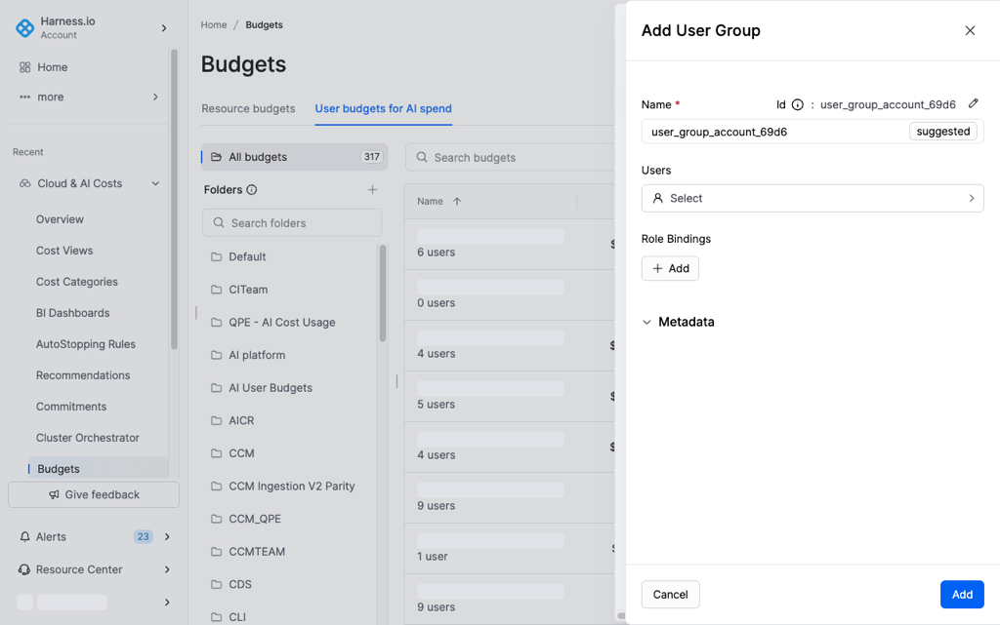

| Field | Description |
|---|---|
| Name | A display name for the group. Harness auto-generates an identifier from it. |
| Users | Click **Select** to add users from your account. Search by name or email and select one or more. After a user is added, click **+ Add Users** to add more. |
| Role Bindings | Assign a **Role** and **Resource Group** to the group. Click **+ Add** to add more role bindings. |
| Metadata | Optional description and tags for the group. |

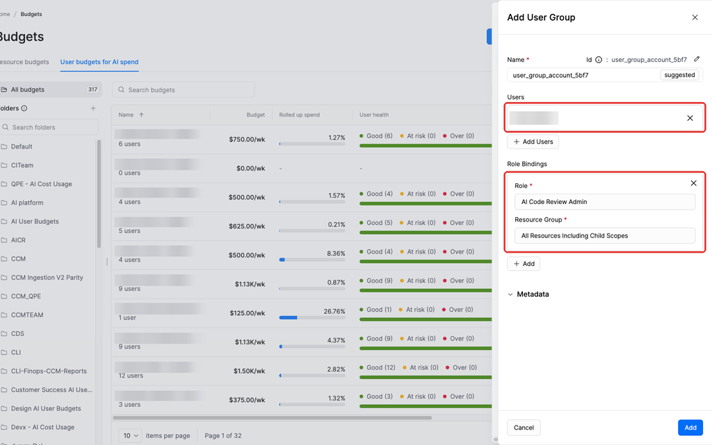

Navigate to [Manage user groups](https://developer.harness.io/harness-platform/use-harness-platform/platform-access-control/add-user-groups) to manage user groups outside the budget wizard.

---

## Create a user budget

1. Navigate to **Cloud & AI Costs**, select **Budgets**, and then select **User budgets for AI spend**.
2. Click **New budget**, and then select **User budget for AI spend**. The **Create a new Budget** panel opens.

### Budget setup

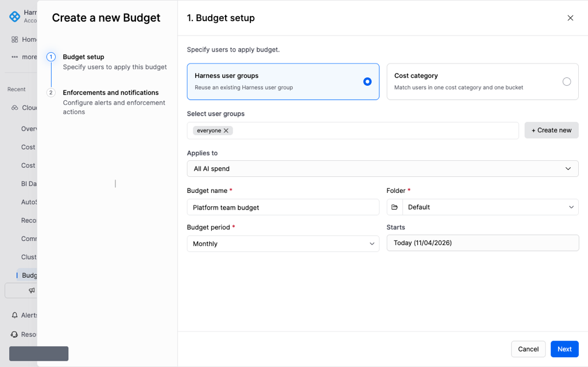

| Field | Description |
|---|---|
| Specify users to apply budget | Select **Harness user groups** to reuse an existing Harness user group, or select **Cost category** to match users in one cost category and one bucket. |
| Select user groups | Select one or more groups from the **Select user groups** dropdown. To create a new group, click **+ Create new**. Navigate to [Create a user group](#create-a-user-group) to create one without leaving the wizard. |
| Applies to | Select which AI providers this budget governs. You can select all providers, a single provider, or any combination: <ul><li>**All AI spend**: Every connected AI provider, including new providers you connect in the future</li><li>**Cursor**: Spend from Cursor IDE</li><li>**Claude**: Spend from Claude</li><li>**GitHub Copilot**: Spend from GitHub Copilot</li><li>**Amazon Bedrock**: Spend from Amazon Bedrock</li></ul> |
| Budget name | Descriptive name for the budget (for example, `CCM Team - Cursor`) |
| Folder | Select a folder for the budget. The dropdown lists existing folders and includes search. **Default** is selected. |
| Budget period | Select the billing cycle: <ul><li>**Weekly**</li><li>**Monthly**</li><li>**Quarterly**</li></ul> Spend resets at the start of each period. Unused budget does not roll over. |
| Starts | Use the date picker to select the start date for the first budget period. |


**Different limits for each provider**

To set a different limit for each provider, create a separate budget for each provider.


Click **Next** to open **Enforcements and notifications**.

### Enforcements and notifications

**Enforcements and notifications** sets the limit for each user, the approval workflow, and the notification rules. The step has three parts: **Budget per user**, **Limit increase requests** (with optional advanced settings), and **Notifications**.

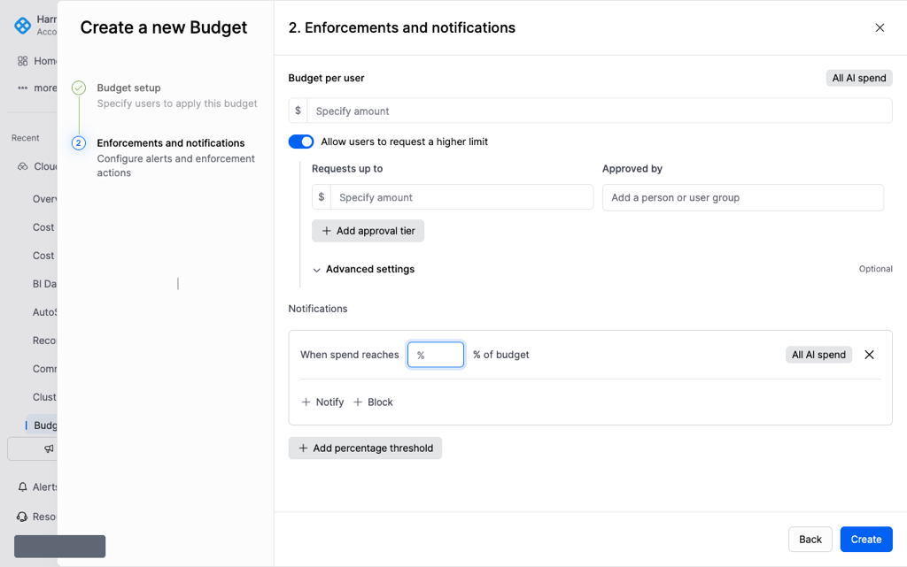

### Budget per user

Enter the dollar amount that each user in the group can spend in a period. The provider badge (for example, **All AI spend**) shows the providers you selected. Navigate to [Budget setup](#budget-setup) to review that selection.

### Limit increase requests

1. Turn on **Allow users to request a higher limit** so users can request an increase from their profile.
2. Set up at least one approval tier to define who approves requests and the maximum amount they can approve. Each tier has the fields described in the following table.
3. Click **+ Add approval tier** to add multiple tiers.

| Field | Description |
|---|---|
| Requests up to | The maximum amount this approver can approve. Harness sends the request to the approver whose tier ceiling matches or exceeds the requested amount. |
| Approved by | Who approves requests at this tier. Select **Auto-approve** to approve requests automatically without manual review. Otherwise, select one or more users or a user group. |

The ceiling of the highest tier is the maximum amount any user can request.

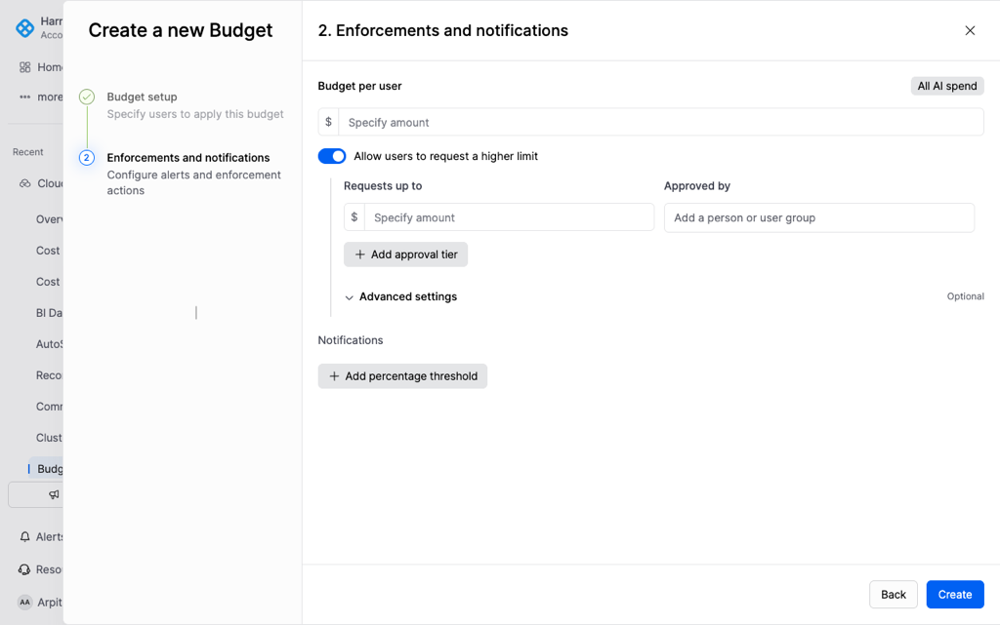

Example: approval tiers

A user has a $125/month budget and needs more. You configure three approval tiers. Harness sends each request to the approver for the requested amount:

| Tier | Requests up to | Approved by |
|---|---|---|
| 1 | $250 | Team lead |
| 2 | $500 | Engineering manager |
| 3 | $750 | VP of Engineering |

* A request for $200 goes to the team lead (Tier 1).
* A request for $400 goes to the engineering manager (Tier 2).
* A request for $700 goes to the VP of Engineering (Tier 3).
* No user can request more than $750, the ceiling of the highest tier.

### Advanced limit increase settings (optional)

Expand **Advanced settings** to set limits on when users can request an increase and how much they can request:

| Field | Description |
|---|---|
| Users can request an increase once spend reaches | The percentage of their current budget a user must consume before they can submit a request. |
| Maximum increase per request | The largest single-request increase allowed. |

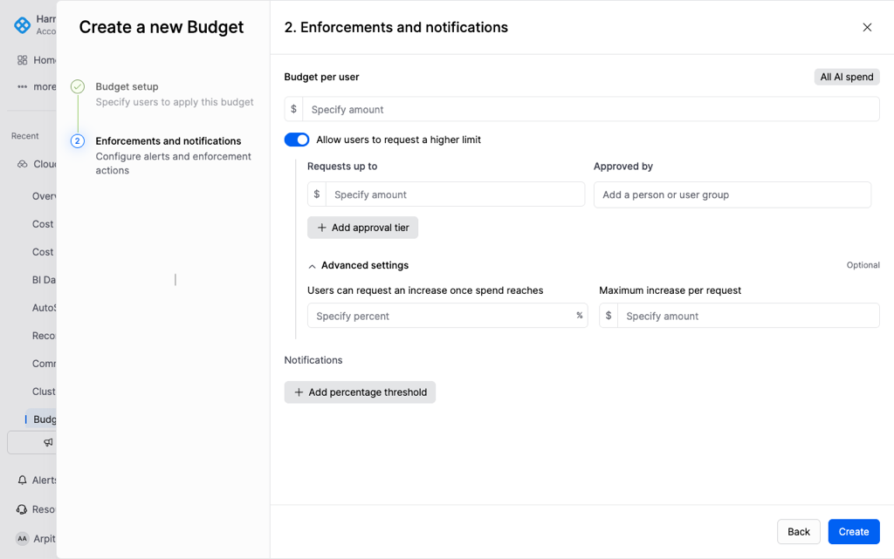

### Notifications

The step includes one threshold row by default.

1. In **When spend reaches**, enter the spend percentage. The row shows **% of budget**.
2. Select the action for the threshold:
   * Click **+ Notify** to email the user when spend reaches the threshold. You can add more recipients.
   * Click **+ Block** to remove the user's access to the selected AI providers when spend reaches the threshold.

For each threshold, you can notify the user, block access, or both. Click **+ Add percentage threshold** to add a row with a different action at a different spend level.


**Emails that Harness always sends**

Harness emails the user when the user is blocked, submits a limit increase request, and is unblocked. Harness sends these emails regardless of the thresholds on this step.


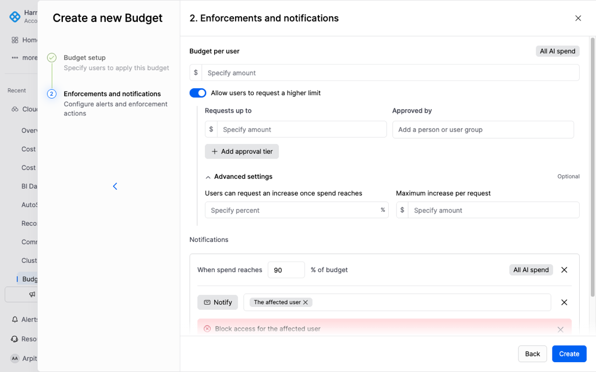

Example: notification thresholds

The budget uses two thresholds:

| When spend reaches | Action |
|---|---|
| 90% | Notify the affected user |
| 100% | Block access for the affected user |

You can also add **Notify** and **Block** to the same threshold, for example to notify the user and block access at 100%.

### Save the budget

Click **Create** to save the budget.

---

## Monitor a user budget

On the user budget list, select a budget name to open its detail page.

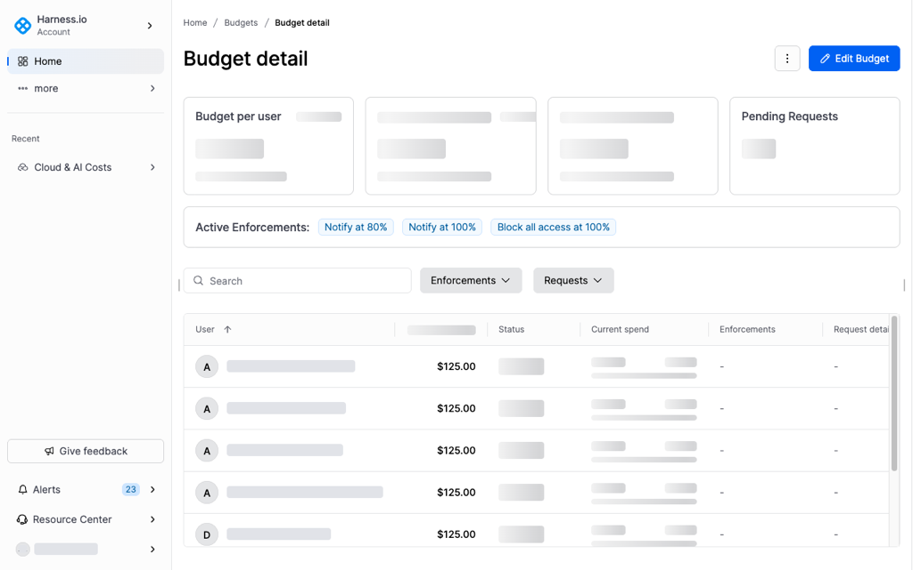

### Read the budget summary

| Tile | Description |
|---|---|
| Budget per user | The per-user limit, provider scope, and total number of users in the budget |
| Total weekly budget | Sum of all users' limits for the current period, with a breakdown of OK, At risk, and Exceeded users. On a weekly budget the tile is **Total weekly budget**. The tile name follows the budget period. |
| Week-to-date spend | Aggregate spend so far, shown as a percentage of the total budget, and how much of the period has elapsed. On a weekly budget the tile is **Week-to-date spend**. The tile name follows the budget period. |
| Pending Requests | Number of outstanding limit increase requests. Click **Review all** to open the review panel. |

The **Active Enforcements** bar lists the notification and block rules for this budget. Each tag shows the action and the threshold. **Notify at 80%** sends an email when a user reaches 80% of the limit. **Block all access at 100%** removes access when spend reaches the limit.

### Read spend for each user

| Column | Description |
|---|---|
| User | User email |
| Weekly budget | The user's current spending limit for the period. The column name follows the budget period. The amount can be higher than the default when an approver approves a limit increase. |
| Status | **OK** (within limit), **At risk** (approaching the threshold), or **Exceeded** (over the limit) |
| Current spend | Dollar amount spent and percentage of their limit, shown as a progress bar |
| Enforcements | Active enforcement applied to this user |
| Request details | Details of any pending limit increase request for this user |


**Filter the table**

Use the **Enforcements** and **Requests** filters above the table to narrow the view to users with active enforcements or pending requests.


---

## Review limit increase requests

Harness routes each submitted request to the approver assigned to the matching approval tier. Navigate to [Approve directly](#approve-directly) to act without opening the review panel. Navigate to [Review request through review panel](#review-request-through-review-panel) to read the request before you decide.

### Approve directly

Use the buttons in the **Request details** column to act on a request without opening the review panel.

* Click the approve icon (✓) to approve the request.
* Click the reject icon (✗) to reject the request.


**Approve your own request**

If you are an administrator and also listed as an approver for your own budget, you can approve your own requests.


### Review request through review panel

Click **Review all** in the **Pending Requests** tile to view all users who have submitted a limit increase request for this budget.

To open one request, click **Review ↗** for the user in the **Request details** column.

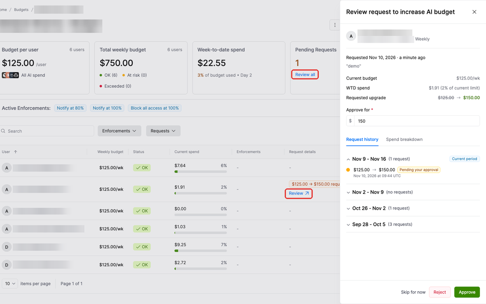

The review panel displays the following details for the selected request:

| Field | Description |
|---|---|
| Current budget | The user's current per-period limit |
| WTD spend | Week-to-date (WTD) spend for the user, and the percentage of the current limit |
| Requested upgrade | The transition from current to requested amount (for example, $125.00 → $130.00) |
| Approve for | The amount to approve. Defaults to the requested amount. You can change it to approve a lesser amount than the user requested. |

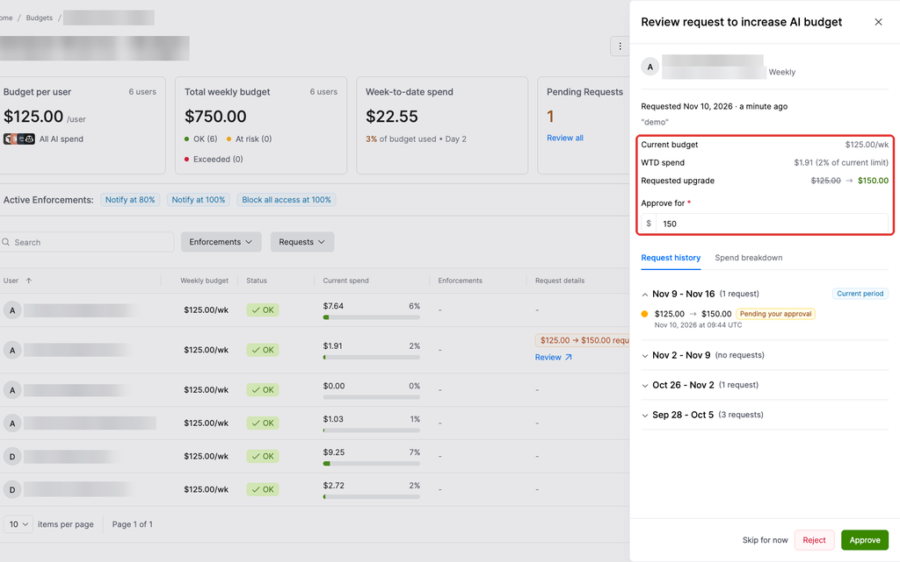

The panel also includes two tabs:

* **Request history**: Displays the user's past requests grouped by budget period.

  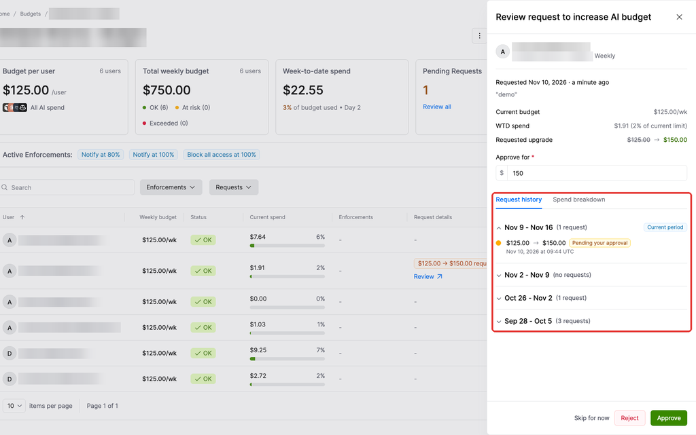

* **Spend breakdown**: Displays a bar chart of the user's daily AI spend. Click **View on explorer** to open Cost Explorer. Use the dropdowns to change the view:
  * **By providers**: By providers, By models, By accounts, By model family, or By token type
  * **By days**: By days, By weeks, or By months

  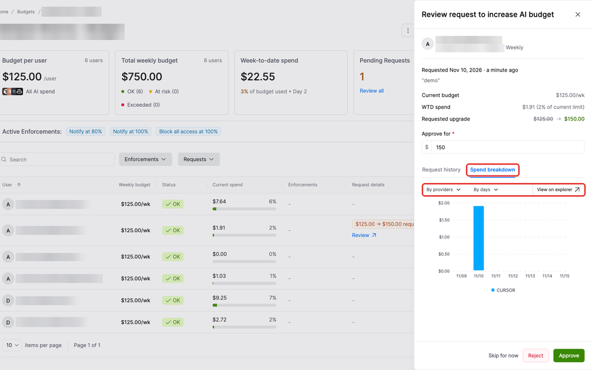

Take one of the following actions:

* **Approve:** Confirm the amount in **Approve for**, then approve the request.
* **Reject:** Decline the request.
* **Skip for now:** Move to the next request without a decision.

---

## Edit or delete a user budget

* On the budget detail page, click **Edit Budget** to reopen the wizard and change a setting.
* To delete the budget, click **Show more actions**, then select **Delete**.


**Deletion removes enforcement**

Deleting a user budget removes all enforcement rules immediately. Users who were blocked regain access.


---

## Troubleshooting

### Anthropic block does not turn on

Enforcement is available for Anthropic Enterprise only. Navigate to [Enable AI Governance on your connector](#enable-ai-governance-on-your-connector) to select **Anthropic Enterprise**.

### Amazon Bedrock access stays open after the limit

Harness cannot block those users until you attach the governance policy to the IAM Identity Center permission set and re-provision the permission set. Navigate to [Enable AI Governance on your connector](#enable-ai-governance-on-your-connector) to attach the policy.

---

## Next steps

* Navigate to [Manage your AI budget](manage-your-ai-budget.md) to view a budget as a user and submit a limit increase request.
* Navigate to [Budgets](../../concepts/budgets.md) to compare a user budget with a resource budget.


