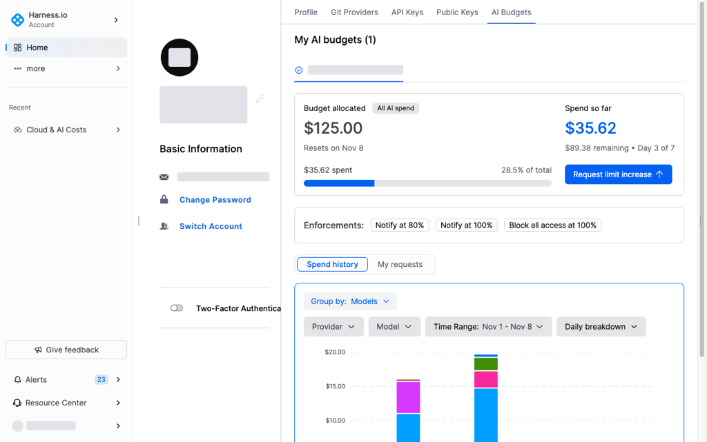
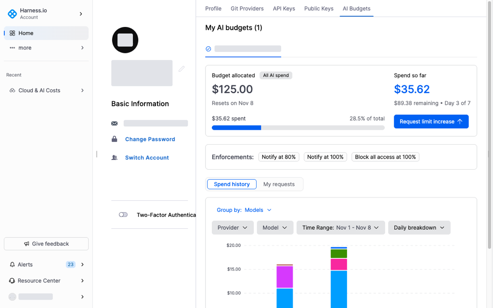
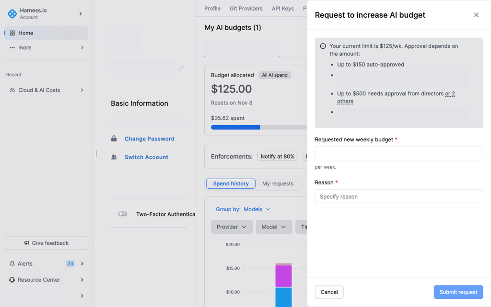
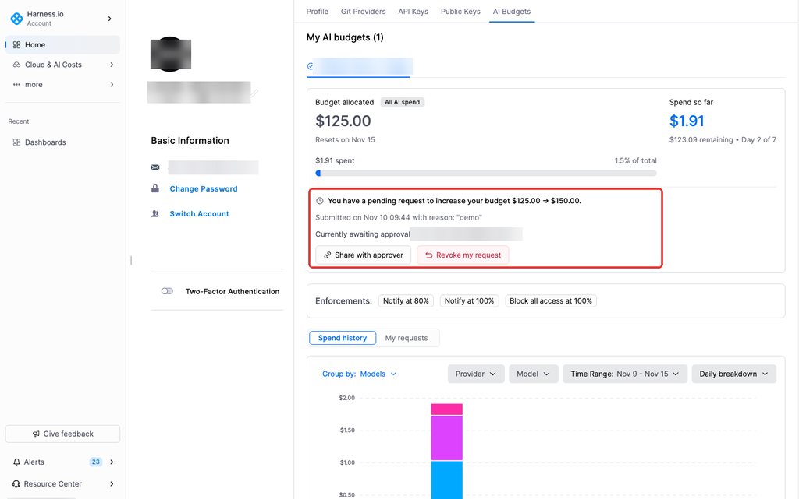

# Manage your AI budget

Your AI budget is the spending limit your administrator sets for you on AI tools. Your Harness profile shows the limit, your spend for the period, and any limit increase requests.

---

## What you will learn from this topic

- **Find your budget:** Where the **AI Budgets** tab is in your profile.
- **Budget card:** What each field on the card shows.
- **History:** How to read spend history and past requests.
- **Request a limit increase:** How to submit a request and track its status.

---

## Before you begin

- **User group:** You belong to a Harness user group that has a user budget.

---

## View your AI budget

1. Click your name or avatar in the bottom-left corner of your Harness account.
2. Select **Profile**.
3. Select the **AI Budgets** tab.

Your budgets are listed under **My AI budgets**. Each card shows the allocation, current spend, and the date the period resets.

| Field | Description |
|---|---|
| Budget allocated | Your spending limit for the period and which AI providers it covers (for example, **All AI spend**) |
| Resets on | When the current period ends and your spend resets to zero |
| Spend so far | How much you have spent, what is left, and which day of the period you are on |
| Progress bar | Your spend as a share of your limit |
| Enforcements | The action Harness takes when your spend reaches a threshold (for example, **Notify at 80%**, **Block all access at 100%**) |

### Spend history

The **Spend history** tab displays a bar chart of your daily AI spend. Use the filters to narrow the data:

| Filter | Options |
|---|---|
| Group by | Providers, Models, Accounts, Model family, Token type |
| Provider | AWS, Azure, Claude Enterprise, Cursor, Devin, GCP |
| Model | Filter by specific model |
| Time Range | Select the date range |
| Breakdown | Daily, Weekly, or Monthly |

### My requests

The **My requests** tab lists your past limit increase requests, the approver who acted on each request, and any notes from the approver.

---

## Request a limit increase

Your administrator sets the approval tiers. Harness routes the request to the approver for the amount you enter.

1. Click **Request limit increase** on the budget card.

   

   The panel shows your current limit and the approver for each amount.

   

2. In the **Requested new budget** field, enter the amount you need. It must be higher than your current limit.
3. Enter a **Reason** for the request.
4. Click **Submit request**.

Harness sends the request to the approver for that amount and notifies the approver. The budget card shows the requested amount, the time you submitted it, and the approver. Navigate to [Review limit increase requests](manage-user-budgets.md#review-limit-increase-requests) to review the approver steps.

When the approver declines the request, the decision and any notes appear on the **My requests** tab.


**A declined request**

The decision and any notes appear on the **My requests** tab. The current limit remains until a request is approved.


To follow up on or withdraw the request, use the actions on the card:

* **Share with approver:** Send the approver a direct link to the request.
* **Revoke my request:** Cancel the request. Harness shows a **Request revoked** notification.

---

## Troubleshooting

### Request limit increase is not on the budget card

The administrator turns on **Allow users to request a higher limit**. Navigate to [Limit increase requests](manage-user-budgets.md#limit-increase-requests) to review that setting.

---

## Next steps

* Navigate to [Create and manage user budgets](manage-user-budgets.md) to create budgets, set approval tiers, and review requests as an administrator.
* Navigate to [Budgets](../../concepts/budgets.md) to compare a user budget with a resource budget.


