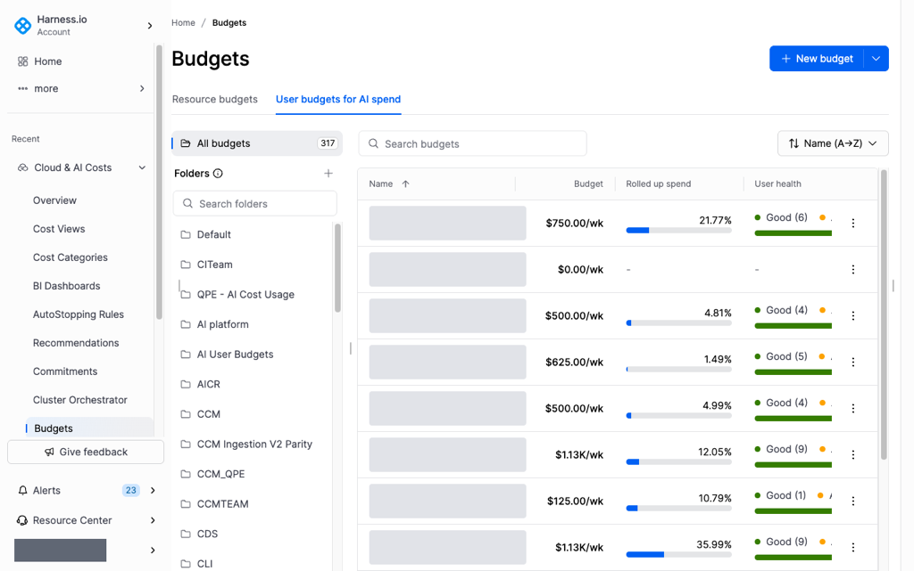
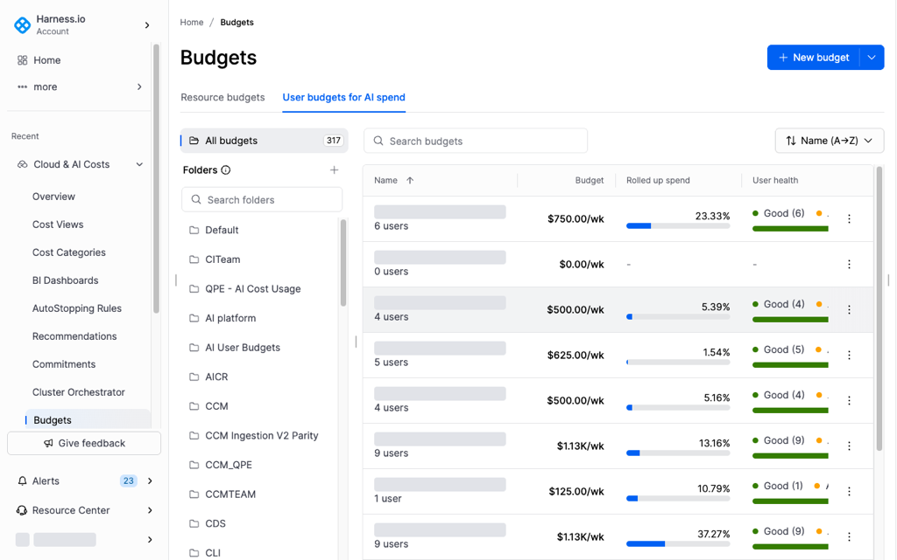
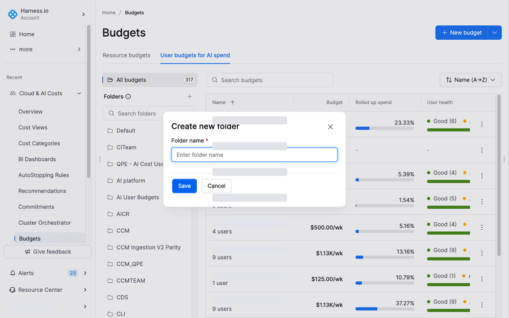
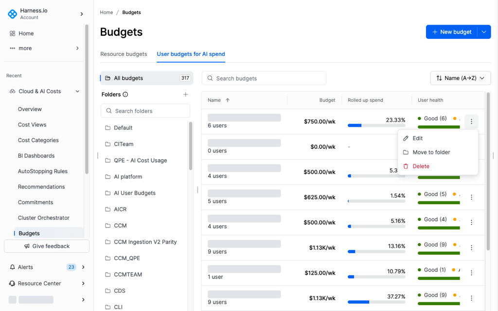

# User budgets overview


```
{
    "featureFlags": [{
        "key": "CCM_USER_BUDGETS",
        "name": "AI User Budgets",
        "status": "GA",
        "description": "Enables the User budgets for AI spend tab on Budgets and the AI Budgets view in user profiles. Administrators can create per-user AI spending budgets with configurable approval workflows and enforcement actions."
    }]
}
```


A user budget sets a spending limit for each user on AI tools such as Cursor, Claude, GitHub Copilot, and Amazon Bedrock. When a user approaches or exceeds the limit, Harness notifies that user and can block access. A user who needs a higher limit requests one from their profile.


**User budgets and resource budgets**

User budgets are separate from resource budgets. Navigate to [Create a resource budget](../budgets/create-a-resource-budget.md) to track cloud spend for a cost view.


---

## What you will learn from this topic

- **List:** What each column on the user budget list shows.
- **Search and sort:** How to find a budget by name and how to order the list.
- **Folders:** How to organize budgets and control who can view them.
- **Row actions:** How to edit, move, or delete a budget from its row.

---

## Before you begin

- **Budget enforcement:** Turn on enforcement on the connector before a block can take effect. Select **AI Governance** on the AWS connector for Amazon Bedrock, or turn on **Enable budget enforcement** on the provider connector for Cursor, GitHub Copilot, and Claude. Navigate to [Create and manage user budgets](manage-user-budgets.md#enable-ai-governance-on-your-connector) to enable it.

---

## View user budgets

In the left navigation, select **Cloud & AI Costs**, and then select **Budgets**. Select **User budgets for AI spend** to view the user budgets in your account.



Each row displays:

| Column | Description |
|---|---|
| Name | Budget name, folder, and the number of users in the budget |
| Budget | Per-user spend limit and billing period (for example, $500.00/wk) |
| Rolled up spend | Aggregate AI spend across all users in the budget for the current period, shown as a percentage and progress bar |
| User health | <ul><li><strong>Good</strong>: all users within limit</li><li><strong>At risk</strong>: one or more users nearing their threshold</li><li><strong>Over</strong>: one or more users have exceeded the limit</li></ul> |
| Notifications and enforcements | Active alert and block rules configured for the budget |
| Upgrade requests | Pending limit increase requests submitted by users in the budget |


**Find and filter budgets**

Use **Search budgets** to find a budget by name. Use the sort dropdown to order the list:

* **Name (A→Z / Z→A)**
* **Created (newest / oldest)**
* **Updated (newest / oldest)**


---

## Folders

Folders organize user budgets and control access. A user with access to a folder can view the budgets in it. Navigate to [Access and auditing](../../concepts/budgets.md#access-and-auditing) to review folder access and the budget permissions. Use a folder for each team.

Select a folder in the **Folders** panel to filter the list. Select **All budgets** to return to the full list.

To create a folder, click the **Add** icon next to **Folders**.



Enter a folder name and click **Save**.



Point to a folder in the panel to show three actions:

| Action | Description |
|---|---|
| **Edit** | Rename the folder |
| **Delete** | Permanently remove the folder |
| **Pin** | Pin the folder to the top of the **Folders** panel |

You can assign a budget to a folder when you create it. To change the folder for an existing budget, click **Show more actions** on the budget row. Select **Move to folder** to change only the folder, or select **Edit** to update the folder and the other budget settings.



---

## Next steps

Navigate to [Create and manage user budgets](manage-user-budgets.md) to create a budget, set enforcement and approval tiers, and review limit increase requests. Navigate to [Budgets](../../concepts/budgets.md) to compare a user budget with a resource budget.


