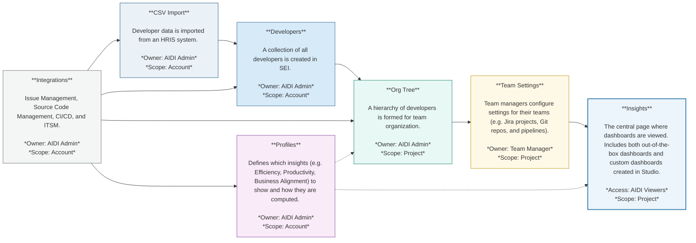

# Key concepts in AI DLC Insights

Harness AI DLC Insights is a complete re-imagination of how engineering organizations can understand, measure, and improve software delivery. It brings together signals across your software delivery lifecycle (SDLC), connects them with organizational context, and transforms them into actionable insights for teams, managers, and executives.

AI DLC Insights is built around a set of flexible building blocks that help you answer critical questions like:

* Are our engineering teams operating efficiently?
* How is work flowing from idea to production?
* Where are the bottlenecks in our delivery pipeline?
* Are we meeting our reliability and velocity goals?

### Core Concepts 

To answer these questions, AI DLC Insights introduces a simplified and extensible data model.

 

This data model diagram walks through how AIDI handles organizational data and insights, including:

* [Developers](key-concepts.md#developers): Imported from HR systems via CSV and managed at the account level.
* [Org Tree(s)](key-concepts.md#org-tree): Developers are grouped based on attributes like `Manager`, `Location`, `Role`, `Employment Type`, or `Project`. Leaf nods of the Org Tree becomes Teams.
* [Team](key-concepts.md#teams): Team Managers are assigned by the AIDI Admin at the project level and configure team-specific settings (e.g. Jira projects, Git repos, production services, and pipelines) influenced by associated Profiles.
* [Profiles](key-concepts.md#profiles): Define which insights to enable and how they are computed, and are associated with one or more Org Trees to guide all insights calculations.
* [Dashboards in Insights](key-concepts.md#dashboards-in-insights): The primary way insights are consumed in AI DLC Insights. Dashboards are generated using data filtered by Profiles, Teams, and Org Tree context, and are [viewed on the **Insights** page](../use-ai-dlc-insights/view-insights/README.md).


The foundation of Harness AIDI is the account-level [Integrations setup](https://app.gitbook.com/s/EYDRcFDt1JPlcws7L5VL/use-software-engineering-insights/setup-sei/configure-integrations) by the AIDI Admin. These integrations must be configured before importing developers or creating Org Trees.


#### Developers 

Developers are the foundational unit in AI DLC Insights. Every insight, metric, and trend in the platform starts with accurate identification and attribution of developer activity across your toolchain.

AIDI automatically handles the complexity of identity mapping across systems like GitHub, GitLab, Jira, Bitbucket, PagerDuty, and more so you don’t have to based on developer email.

Developers can belong to multiple teams across different Org Trees and Projects, based on the grouping logic defined in your Org Tree.

#### Org Tree 

The Org Tree represents your organizational hierarchy and structure in AI DLC Insights. It provides the foundation for grouping developers and replicating the org hierarchy into AI DLC Insights. At present, the Org Tree is powered by CSV-based imports from your HRIS system (e.g., Workday, BambooHR). The CSV must include a contributor attribute (such as ManagerEmail or ManagerID) that defines the reporting relationship between individuals.

Using this structure, AI DLC Insights automatically builds a manager and reportee tree, allowing you to view and analyze metrics in the context of real-world teams and reporting lines.

Multi-level groupings based on custom attributes (e.g., Department → Function → Team) are supported in AI DLC Insights. This allows organizations to model more complex hierarchies and operational structures, making it easier to analyze engineering performance across departments, locations, and lines of business.

#### Teams 

Teams are the core unit of measurement in AI DLC Insights. Every leaf node in the Org Tree is treated as a Team, making it the fundamental grouping for surfacing insights, applying goals, and driving accountability.

Each Team represents a group of developers working together within the organizational hierarchy and is automatically derived from the Org Tree structure.

**Key Characteristics**

* **Auto-derived:** Every leaf node in the Org Tree is automatically considered a Team.
* **Configurable:** Each Team has its own configuration to define how metrics are calculated and displayed.
* **Contextualized and metric specific settings:** Teams include metadata such as associated integrations, relevant services, repositories, destination branches, pipelines, environments, etc.

This configuration layer adds precision to how metrics like Deployment Frequency, Lead Time, MTTR, and others are calculated, which ensures each metric reflects the real scope, velocity, and complexity of the team's delivery lifecycle.

#### Profiles 

**Profiles** control **what AI DLC Insights measures** and **how it measures it** by enabling or disabling specific metrics and defining which event types power those metrics. They provide a flexible way to customize AI DLC Insights insights to your organization’s goals and workflows.

Each Profile includes which **metrics** are enabled or disabled (e.g., Deployment Frequency, Lead Time, Change Failure Rate) and the **events and signals** that power those metrics.

**Types of Profiles**

AI DLC Insights supports three main types of Profiles, each optimized for different measurement objectives:

| Type of profile    | Purpose                                               | Metrics                                                                                                                                   |
| ------------------ | ----------------------------------------------------- | ----------------------------------------------------------------------------------------------------------------------------------------- |
| Efficiency         | Delivery performance (DORA metrics) & sprint insights | Deployment Frequency, Lead Time for Changes, Change Failure Rate, MTTR                                                                    |
| Productivity       | Developer productivity and collaboration              | PR Velocity per Dev, PR Cycle Time, Work Completed Per Dev, Coding Days Per Dev, Number of Comments Per PR, Average Time to First Comment |
| Business Alignment | Alignment of engineering output to business goals     | Business Alignment                                                                                                                        |

**Relationship to Org Tree & Teams**

* Teams define **where the data comes from** (repositories, pipelines, services, etc).
* Profiles define **what data is used and how** to calculate each metric.
* Each **Org Tree** can have **only one Profile of each type** (Efficiency, Productivity, Business Alignment).
* The assigned Profile applies to the **entire Org Tree and all Teams within it**.
* This ensures consistent measurement and reporting across all organizational units under that tree.

Together, Developers, Org Trees, Teams, and Profiles define how data is collected, grouped, and calculated in AI DLC Insights. This data is surfaced in dashboards on the [**Insights** page](../use-ai-dlc-insights/view-insights/README.md).

#### Dashboards in Insights 

AI DLC Insights surfaces all metrics and insights through dashboards on the **Insights** page, where dashboards are viewed and shared. These include both out-of-the-box dashboards and custom dashboards created by your team.

Whether you're focused on shipping faster, improving collaboration, or aligning engineering with business goals, the **Insights** page is your central place to track performance.

**Out-of-the-box dashboards**

AI DLC Insights includes the following pre-built dashboards designed to deliver value from day one:

*   **Efficiency**: Get a complete picture of your engineering throughput and stability. The experience combines **DORA Metrics** and **Sprint Insights** to highlight how reliably and predictably your teams are delivering

    

    | Metric                | Description                                                       |
    | --------------------- | ----------------------------------------------------------------- |
    | Deployment Frequency  | How often code is successfully deployed to production.            |
    | Lead Time for Changes | Time taken for code to go from commit to production.              |
    | MTTR                  | Mean Time to Recovery after a failure in production.              |
    | Change Failure Rate   | Percentage of deployments that result in a failure in production. |
*   **Productivity**: Understand how developers are working across pull requests, reviews, commits, and collaboration. Built for visibility into the day-to-day collaboration and flow of your teams.

    | Metric                        | Description                                                |
    | ----------------------------- | ---------------------------------------------------------- |
    | PR Velocity per Dev           | Number of pull requests completed per developer.           |
    | PR Cycle Time                 | Time taken for a pull request to go from open to merged.   |
    | Work Completed Per Dev        | Amount of work completed per developer over time.          |
    | Coding Days Per Dev           | Number of days a developer actively contributes code.      |
    | Number of Comments Per PR     | Average number of comments on pull requests.               |
    | Average Time to First Comment | Time taken to receive the first comment on a pull request. |
*   **Business Alignment**: The one dashboard that you need to track how engineering output maps to product and business goals.

    

<strong>BUILT FOR EVERY LEVEL OF THE ORG</strong>

All dashboards are automatically scoped using your <strong>Org Tree</strong>, <strong>Teams</strong>, and <strong>Profiles</strong> so each viewer (from developer, team lead, to executives) sees the insights most relevant to them.

**Studio dashboards**


Studio dashboards are in beta. To request access, contact [Harness Support](https://app.gitbook.com/s/EYDRcFDt1JPlcws7L5VL/troubleshooting-and-resources/sei-support).


If the out-of-the-box dashboards on the **Insights** page don’t meet your needs, you can use [Studio](../use-ai-dlc-insights/studio.md) to create custom dashboards in AI DLC Insights.

Studio is where dashboards are created and managed. Once created, they are published to the **Insights** page, where they can be viewed and shared across your team.


